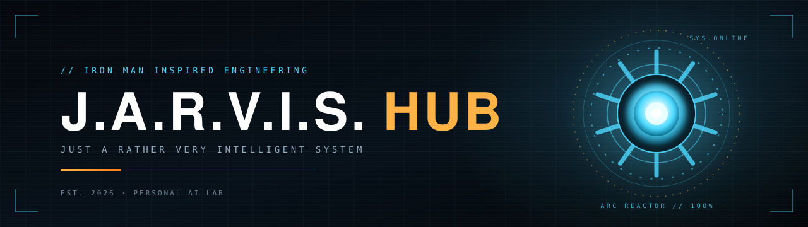

  

<h3 align="center">Un laboratorio, non una vetrina.</h3>

  <b>J.A.R.V.I.S. Hub</b> è lo spazio dove prendono forma assistenti, automazioni e interfacce 
  ispirati all'universo di Iron Man. Sistemi reali, con memoria, voce e capacità di agire.

  <code>JUST A RATHER VERY INTELLIGENT SYSTEM</code> · codice che gira, non mockup.

  
  
  
  

---

## `//` Il progetto principale

### Project J.A.R.V.I.S.

**L'assistente personale che vive su Telegram.** Ascolta, ricorda, analizza documenti, genera report, controlla il Mac e la casa ed esegue protocolli con un solo comando.

| Sistema | Cosa fa |
| :--- | :--- |
| 🧠 **Memoria** | Sessioni persistenti, profilo strutturato e personalità selezionabili. |
| 🎙️ **Voce e visione** | Wake word, trascrizione, TTS, analisi dello schermo e della webcam. |
| 📊 **Analisi** | Grafici, PDF, simulazioni what-if, quality control e knowledge base con citazioni. |
| 🏠 **Casa e Mac** | Home Assistant, app macOS, musica, notifiche, presenza e protocolli. |
| 🔐 **Sicurezza** | Allowlist single-user, audit log, approvazioni e sandbox Docker. |

  
  
  

  
  
  
  
  
  
  
  

---

## `//` Dentro l'hub

| 01 · Assistenti | 02 · Automazioni | 03 · Interfacce |
| :--- | :--- | :--- |
| Sistemi che ricordano il contesto, riconoscono una voce e sanno quando farsi avanti. | Azioni concrete su Mac, casa e documenti. Non solo risposte: conseguenze. | HUD, protocolli e design che rende la tecnologia viva, non solo utile. |

---

## `//` In cantiere

> **Nuovi sistemi in arrivo.** J.A.R.V.I.S. Hub crescerà con altri progetti ispirati a Iron Man: nuovi assistenti, automazioni e interfacce. Ogni repository avrà lo stesso standard: codice leggibile, test, documentazione e sicurezza by design.

Se vuoi seguire l'evoluzione, metti una ⭐ a [Project J.A.R.V.I.S.](https://github.com/J-A-R-V-I-S-hub/Project_J.A.R.V.I.S.) e torna a trovarci.

---

## `//` Autore

Progettato e sviluppato da **Henry** — sviluppatore e sperimentatore, con una passione sospetta per i sistemi che parlano.

  
  
  
  

   
  <i>“Sometimes you gotta run before you can walk.”</i> — Tony Stark  

   
  © 2026 J.A.R.V.I.S. Hub · Rilasciato sotto licenza MIT

